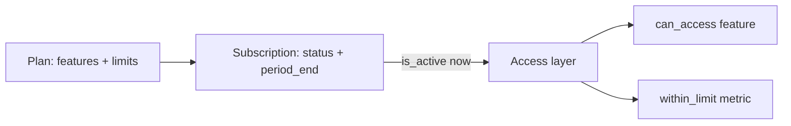

<p align="center">
  
</p>

<h1 align="center">Subscription Paywall</h1>

<p align="center">
  <strong>Plans, entitlements, and access checks with trial/expiry — in Python.</strong><br>
  Define tiers, bind customers to plans, then gate features and enforce usage limits with one call.
</p>

<p align="center">
  <em>Built and maintained by <a href="https://viprasol.com">Viprasol Tech</a> — Fintech Experts. Full-Stack Builders.</em>
</p>

<p align="center">
  <a href="https://github.com/Viprasol-Tech/subscription-paywall/actions/workflows/ci.yml"></a>
  <a href="LICENSE"></a>
  
  <a href="https://t.me/viprasol_help"></a>
  <a href="https://github.com/Viprasol-Tech/subscription-paywall/stargazers"></a>
</p>

---

## Features

- **Plan catalogue** — declarative free / pro / enterprise tiers with feature entitlements and named usage limits.
- **Subscription lifecycle** — `active`, `trialing`, `past_due`, `canceled`, plus a `current_period_end` for expiry.
- **Deterministic liveness** — `is_active(now)` takes an injected clock, so every check is reproducible and testable.
- **Feature gating** — `can_access(subscription, feature, now)` returns an allow/deny decision with a reason code.
- **Limit enforcement** — `within_limit(subscription, metric, current_usage)` enforces caps at and over the boundary; `None` means unlimited.
- **Upgrade-aware** — swap a plan and entitlements/limits update immediately, with the original left untouched.
- **CLI** — `subscription-paywall demo` evaluates several subscriptions offline against a fixed instant.
- **Modern tooling** — ruff, mypy (strict), pytest, GitHub Actions CI.

## Quickstart

```bash
git clone https://github.com/Viprasol-Tech/subscription-paywall.git
cd subscription-paywall
python -m pip install -e ".[dev]"

# Evaluate access and limits for sample subscriptions:
subscription-paywall demo
```

## Usage

```python
from datetime import datetime, timezone

from subscription_paywall import can_access, get_plan, within_limit
from subscription_paywall.subscription import Subscription, SubscriptionStatus

now = datetime(2025, 6, 1, tzinfo=timezone.utc)
sub = Subscription(
    plan=get_plan("pro"),
    status=SubscriptionStatus.ACTIVE,
    current_period_end=datetime(2025, 7, 1, tzinfo=timezone.utc),
)

can_access(sub, "api_access", now).allowed          # True  (pro entitles it)
can_access(sub, "sso", now).reason                  # 'feature_not_in_plan'
within_limit(sub, "seats", current_usage=4).allowed  # True  (cap 5, +1 == 5)
within_limit(sub, "seats", current_usage=5).reason   # 'limit_exceeded'

enterprise = sub.with_plan(get_plan("enterprise"))
can_access(enterprise, "sso", now).allowed           # True  (upgrade unlocks it)
```

## Architecture



## Roadmap

- [x] Plan catalogue with entitlements and limits
- [x] Subscription lifecycle + `is_active(now)`
- [x] `can_access` feature gating and `within_limit` enforcement
- [ ] Proration and mid-period plan changes
- [ ] Metered/usage-based billing adapters
- [ ] Webhook ingestion for provider lifecycle events

## Contributing

PRs welcome — see [CONTRIBUTING.md](CONTRIBUTING.md) and our [Code of Conduct](CODE_OF_CONDUCT.md).

## Contact — Viprasol Tech Private Limited

- Website: [viprasol.com](https://viprasol.com)
- Email: [support@viprasol.com](mailto:support@viprasol.com)
- Telegram: [t.me/viprasol_help](https://t.me/viprasol_help) | WhatsApp: +91 96336 52112
- GitHub: [@Viprasol-Tech](https://github.com/Viprasol-Tech) | [LinkedIn](https://www.linkedin.com/in/viprasol/) | X [@viprasol](https://twitter.com/viprasol)

## License

[MIT](LICENSE) (c) 2025 Viprasol Tech Private Limited
